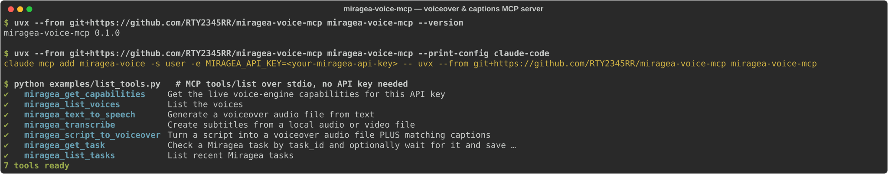

# Voiceover & Captions MCP Server for AI Agents — text-to-speech, voice cloning and SRT/VTT subtitles for Claude, Cursor and Codex

[](https://github.com/RTY2345RR/miragea-voice-mcp/actions/workflows/ci.yml)
[](https://github.com/RTY2345RR/miragea-voice-mcp/releases)
[](pyproject.toml)
[](https://huggingface.co/spaces/miragea/miragea-voice-mcp)
[](LICENSE)
[](https://modelcontextprotocol.io)

**Voiceover & captions MCP server for AI agents.** This open-source [Model Context Protocol](https://modelcontextprotocol.io) server gives Claude Desktop, Claude Code, Cursor, OpenAI Codex, VS Code and Windsurf a script-to-voiceover workflow: give it a script and it returns a narration audio file (MP3, WAV, FLAC, Opus, AAC or PCM) plus matching SRT and WebVTT captions in one tool call. It can clone a voice from a reference audio URL, use the voices saved in your account, and transcribe any local audio or video file into subtitles. Voiceover, voice cloning and speech recognition run on the [Miragea](https://miragea.ai) voice engine. It installs with one command (`uvx --from git+https://github.com/RTY2345RR/miragea-voice-mcp miragea-voice-mcp`), needs only a `MIRAGEA_API_KEY`, and is MIT licensed.

**Try it in the browser:** [live demo on Hugging Face Spaces](https://huggingface.co/spaces/miragea/miragea-voice-mcp) · **Source:** [github.com/RTY2345RR/miragea-voice-mcp](https://github.com/RTY2345RR/miragea-voice-mcp)

> **Install note:** the PyPI package (`uvx miragea-voice-mcp` / `pip install miragea-voice-mcp`) is coming soon. Until then, install straight from GitHub as shown below — it is the same code and the same `miragea-voice-mcp` command.

<!-- mcp-name: io.github.RTY2345RR/miragea-voice-mcp -->



```text
You:    Turn script.txt into a calm voiceover with captions for a YouTube Short.
Agent:  miragea_script_to_voiceover(script_file="script.txt", actor_id="…", tags=["calm"])
        → ~/Miragea/my-short.mp3  ~/Miragea/my-short.srt  ~/Miragea/my-short.vtt
```

---

## Contents

- [How it works](#how-it-works)
- [Features](#features)
- [Quickstart (60 seconds)](#quickstart-60-seconds)
- [Client setup: Claude Desktop, Claude Code, Cursor, Codex, VS Code, Windsurf](#client-setup)
- [Tools reference](#tools-reference)
- [Example prompts](#example-prompts)
- [Configuration](#configuration)
- [How it compares](#how-it-compares)
- [FAQ](#faq)
- [Troubleshooting](#troubleshooting)
- [Agent Skill](#companion-agent-skill)
- [Development](#development)
- [Links](#links)

## How it works


1. Your AI agent (Claude Desktop, Claude Code, Cursor, OpenAI Codex, VS Code or Windsurf) calls a tool such as `miragea_script_to_voiceover` over the Model Context Protocol (stdio).
2. The server checks the request against the live voice-engine capabilities (models, emotion tags, formats, text length) and adds an idempotency key.
3. The [Miragea](https://miragea.ai) voice engine generates the narration (or clones a voice from your reference clip), then runs speech recognition on the new audio for timestamps.
4. The server writes `.mp3` + `.srt` + `.vtt` side by side, with captions that keep your exact script wording, ready to import into your video editor.

## Features

- **Script → voiceover + captions in one call.** `miragea_script_to_voiceover` generates the narration, times captions by running Miragea speech recognition on the new audio, and writes `.mp3` + `.srt` + `.vtt` side by side, ready for CapCut, Premiere Pro, DaVinci Resolve, YouTube, TikTok, Reels and Shorts.
- **Captions spelled like your script.** Recognition can mishear brand names ("Miragea" → "Mirage ear"). By default the server keeps the recognized *timing* but puts back your *exact script wording*, snapping cue breaks to sentence ends.
- **Short-form friendly caption lengths.** `max_caption_chars` (default 42 for scripts) splits long cues and shares their time by length, so captions stay readable on vertical video.
- **Two voice sources.** Use a voice already saved in your Miragea account (`actor_id`), or clone from a public reference audio URL (`reference_audio_url` + optional `reference_text`).
- **Expressive or standard models, emotion tags, speed 0.25–4×.** Options are read live from `/capabilities`, and every argument is validated *before* a job is submitted.
- **Subtitles for any audio or video file.** `miragea_transcribe` uploads mp3/wav/m4a/mp4/mov… and saves SRT, VTT, TXT or JSON (text, language, timed segments).
- **No duplicate jobs on retry.** Every job carries an `Idempotency-Key`; network errors and 502/503/504 are retried with the *same* key, so a retry never creates a second job. Timeouts return the `task_id` so the agent resumes with `miragea_get_task` instead of resubmitting.
- **Never overwrites files.** Existing outputs get `-2`, `-3`… suffixes.
- **Secret-safe.** The key is read from the environment, never logged, never echoed in errors, never sent to the audio download host, and API redirects are not followed.
- **Starts without a key.** Tool listing works with no key (handy for registries and inspectors); calls return a clear "set MIRAGEA_API_KEY" message.
- **Works on MCP Python SDK 1.x and 2.x**, Python 3.10–3.13, macOS, Windows and Linux. Two dependencies: `mcp` and `httpx`.

## Quickstart (60 seconds)

1. **Get a voice-engine key.** The server uses [Miragea](https://miragea.ai) for voiceover, voice cloning and recognition. Sign in and create an API key at **[miragea.ai/workspace/api](https://miragea.ai/workspace/api)**.
2. **Install [uv](https://docs.astral.sh/uv/)** if you don't have it: `curl -LsSf https://astral.sh/uv/install.sh | sh` (macOS/Linux) or `powershell -c "irm https://astral.sh/uv/install.ps1 | iex"` (Windows).
3. **Add the server to your client** (Claude Code shown; others below):

```bash
claude mcp add miragea-voice -s user -e MIRAGEA_API_KEY=<your-miragea-api-key> -- uvx --from git+https://github.com/RTY2345RR/miragea-voice-mcp miragea-voice-mcp
```

4. **Verify** (read-only, creates no job):

```bash
MIRAGEA_API_KEY=<your-miragea-api-key> uvx --from git+https://github.com/RTY2345RR/miragea-voice-mcp miragea-voice-mcp --check
```

Then ask your agent: *"List my Miragea voices, then read 'Welcome back to the channel!' in the first English one."*

> Prefer pip? `pip install git+https://github.com/RTY2345RR/miragea-voice-mcp` (PyPI release coming soon) and use `"command": "miragea-voice-mcp"` with no `args` in the snippets below.

## Client setup

Print any snippet with `uvx --from git+https://github.com/RTY2345RR/miragea-voice-mcp miragea-voice-mcp --print-config <client>` (`claude-desktop`, `cursor`, `claude-code`, `codex`, `vscode`, `windsurf`). Replace `<your-miragea-api-key>` and restart the client.

### Claude Desktop

Settings → Developer → Edit Config (`~/Library/Application Support/Claude/claude_desktop_config.json` on macOS, `%APPDATA%\Claude\claude_desktop_config.json` on Windows):

```json
{
  "mcpServers": {
    "miragea-voice": {
      "command": "uvx",
      "args": ["--from", "git+https://github.com/RTY2345RR/miragea-voice-mcp", "miragea-voice-mcp"],
      "env": { "MIRAGEA_API_KEY": "<your-miragea-api-key>" }
    }
  }
}
```

### Claude Code

```bash
claude mcp add miragea-voice -s user -e MIRAGEA_API_KEY=<your-miragea-api-key> -- uvx --from git+https://github.com/RTY2345RR/miragea-voice-mcp miragea-voice-mcp
```

### Cursor

`~/.cursor/mcp.json` (global) or `.cursor/mcp.json` (project) — same JSON as Claude Desktop.

### OpenAI Codex (CLI and IDE extension)

`~/.codex/config.toml`:

```toml
[mcp_servers.miragea-voice]
command = "uvx"
args = ["--from", "git+https://github.com/RTY2345RR/miragea-voice-mcp", "miragea-voice-mcp"]
tool_timeout_sec = 900
env = { MIRAGEA_API_KEY = "<your-miragea-api-key>" }
```

`tool_timeout_sec` matters: voiceover jobs can take longer than Codex's default tool timeout.

### VS Code (Copilot agent mode)

`.vscode/mcp.json`:

```json
{
  "servers": {
    "miragea-voice": {
      "type": "stdio",
      "command": "uvx",
      "args": ["--from", "git+https://github.com/RTY2345RR/miragea-voice-mcp", "miragea-voice-mcp"],
      "env": { "MIRAGEA_API_KEY": "<your-miragea-api-key>" }
    }
  }
}
```

### Windsurf

`~/.codeium/windsurf/mcp_config.json` — same JSON as Claude Desktop.

## Tools reference

| Tool | What it does |
| --- | --- |
| `miragea_get_capabilities` | Live models (`expressive`, `standard`), emotion tags per model, formats, speed range, max characters per request, subtitle formats and upload limits. **Call first.** |
| `miragea_list_voices` | Voices saved in your account (`actor_id`, `name`, `language`), paged; `search` finds a name across pages. |
| `miragea_text_to_speech` | Text (or `text_file`) → audio file. Voice via `actor_id` **or** `reference_audio_url` (+ `reference_text`). Options: `model`, `tags`, `speed`, `format`, `language`, `output_path`, `wait`. |
| `miragea_transcribe` | Local audio/video → subtitles in `srt`, `vtt`, `txt`, `json`; `max_caption_chars` for short cues. |
| `miragea_script_to_voiceover` | Script → audio + captions (SRT + VTT by default). `caption_text="script"` (exact wording) or `"recognized"`; `captions=false` for audio only; `name`, `output_dir`. |
| `miragea_get_task` | Check or resume any job by `task_id`; with `wait=true` it saves the audio or subtitles. |
| `miragea_list_tasks` | Recent jobs, newest first. |

Every generation tool returns `task_id`, `status` and the `idempotency_key` it used, plus the saved file paths.

## Example prompts

- "Make a 30-second product-ad voiceover from `ad.txt` with my *Nova* voice, happy tone, 1.1× speed, and give me SRT + VTT with short captions."
- "Clone the voice at `https://example.com/me.wav` (it says: 'Hi, I'm Sam and this is my test.') and narrate `intro.md` as WAV."
- "Create subtitles for `~/Videos/vlog.mp4` as SRT and VTT."
- "That voiceover timed out — resume task `…` and save it to `~/Desktop/episode-3.mp3`."
- "What models and emotion tags does my Miragea account have, and how many characters can I send per request?"

## Configuration

| Variable | Default | Purpose |
| --- | --- | --- |
| `MIRAGEA_API_KEY` | — (required for calls) | Your key from [miragea.ai/workspace/api](https://miragea.ai/workspace/api). |
| `MIRAGEA_OUTPUT_DIR` | `~/Miragea` | Where relative output paths and default file names go. Absolute paths are used as given. |
| `MIRAGEA_BASE_URL` | `https://miragea.ai/v1` | API root including `/v1` (for private deployments). |
| `MIRAGEA_WAIT_TIMEOUT` | `600` | Max seconds a tool waits for a job before returning its `task_id`. |
| `MIRAGEA_HTTP_TIMEOUT` | `60` | Per-request HTTP timeout in seconds. |

## How it compares

Honest snapshot from each project's public README (November 2026). "–" means not offered or not documented.

| | **This server** | [elevenlabs-mcp](https://github.com/elevenlabs/elevenlabs-mcp) (local) | [AllVoiceLab-MCP](https://github.com/allvoicelab/AllVoiceLab-MCP) | [better-tts-mcp](https://github.com/CatVinci-Studio/better-tts-mcp) |
| --- | --- | --- | --- | --- |
| Status | Active | Deprecated in favor of ElevenLabs' hosted MCP | Active | Active |
| Voice engine | Miragea | ElevenLabs API | AllVoiceLab API | Microsoft Edge read-aloud (unofficial, no key) |
| One-command install | `uvx --from git+https://github.com/RTY2345RR/miragea-voice-mcp miragea-voice-mcp` (PyPI `uvx miragea-voice-mcp` soon) | `uvx elevenlabs-mcp` | `uvx allvoicelab-mcp` | `uvx better-tts-mcp` |
| Required config | 1 env var | 1 env var | Key **and** matching region domain | None |
| Ready snippets for Claude Desktop / Claude Code / Cursor / Codex / VS Code / Windsurf | All six + `--print-config` | Claude Desktop + `--print` helper | Claude Desktop, Cursor | Claude Desktop, Claude Code |
| Voice cloning from a sample | Reference audio URL | Yes (voice library) | Yes | – |
| Subtitles from your own audio/video (speech) | SRT, VTT, TXT, JSON | Speech-to-text (text) | OCR of burned-in subtitles | – |
| Script → audio **+ captions** in one call | Yes | – | – | Audio + SRT |
| Captions keep exact script spelling | Yes | – | – | Yes (from TTS) |
| No duplicate jobs on retry (idempotency keys) + resume by task ID | Yes | – | – | – |

Where the others are ahead: ElevenLabs and AllVoiceLab cover more audio tasks (sound effects, voice changer, dubbing, agents), and better-tts-mcp needs no key and offers batch and multi-voice synthesis. This server stays focused on the video-creator loop of **script → voiceover → captions** and does that one loop end to end.

## FAQ

### How do I add text-to-speech to Claude Desktop?
Add the `miragea-voice` block from [Claude Desktop](#claude-desktop) to `claude_desktop_config.json`, put your Miragea API key in `env`, and restart Claude. Claude can then call `miragea_text_to_speech` and save MP3 files to `~/Miragea`.

### How do I generate SRT subtitles from a video with an AI agent?
Ask the agent to run `miragea_transcribe` on the file (for example, *"make SRT and VTT subtitles for ~/Videos/clip.mp4"*). The server uploads it to Miragea speech recognition and writes `clip.srt` / `clip.vtt`.

### Can an MCP server make a voiceover with matching captions for YouTube Shorts or TikTok?
Yes. `miragea_script_to_voiceover` returns the audio plus SRT/VTT captions timed to that audio, with cues capped at 42 characters by default for vertical video. Import both into CapCut, Premiere Pro or DaVinci Resolve.

### Does it support voice cloning?
Yes. Pass `reference_audio_url` (a public http(s) link to a clean sample) and, ideally, `reference_text` with the exact words spoken in it. Supplying the exact text gives the most faithful clone; if you omit it, Miragea recognizes it automatically. Only clone voices you have the right to use.

### Does it work with Cursor, Claude Code and OpenAI Codex?
Yes, with any MCP client that supports stdio servers. Run `uvx --from git+https://github.com/RTY2345RR/miragea-voice-mcp miragea-voice-mcp --print-config cursor` (or `claude-code`, `codex`, `vscode`, `windsurf`, `claude-desktop`) for a ready snippet.

### Which audio formats can I export?
MP3 (default), WAV, FLAC, Opus, AAC and PCM. Subtitles: SRT, WebVTT, plain text, and JSON with timed segments.

### Can I use it without an API key or with another TTS engine?
No. Miragea is the only voice engine; there is no hidden fallback. Without a key the server still starts and lists its tools, and every call explains how to add the key.

### Is my API key safe?
The key stays in your local MCP config or environment. The server never prints or logs it, redacts it from errors, sends it only to the Miragea API root (redirects are refused), and never sends it to the audio download URL.

### What happens if a long voiceover times out?
The job keeps running on Miragea. The tool returns the `task_id`; ask the agent to call `miragea_get_task` with `wait=true` to download the result. Don't resubmit, because that would create a duplicate job.

### Can I use it in Python scripts or n8n instead of chat?
Any MCP-capable runtime works. For plain scripts, call the Miragea REST API directly ([guide](https://miragea.ai/v1/guide), [OpenAPI schema](https://miragea.ai/v1/schema)).

## Troubleshooting

| Symptom | Fix |
| --- | --- |
| `MIRAGEA_API_KEY is not set` | Add the key to the server's `env` block (not your shell profile, for GUI clients) and fully restart the client. |
| `HTTP 401 invalid_api_key` | The key is wrong or revoked. Create a new one at [miragea.ai/workspace/api](https://miragea.ai/workspace/api). Run `uvx --from git+https://github.com/RTY2345RR/miragea-voice-mcp miragea-voice-mcp --check`. |
| `HTTP 403` | The account has no API access right now; check it in your Miragea account. `cloudflare_blocked` means a proxy or VPN is being challenged; try another network. |
| `HTTP 429` | Rate-limited or an account limit was reached. Check your Miragea account, or wait and retry. |
| `Text is N characters but this account allows M` | Split the script into parts under `audio.max_text_length` and generate them one by one. |
| `wait_timeout` | The job is still running. Use `miragea_get_task` with the returned `task_id`. Raise `MIRAGEA_WAIT_TIMEOUT` and your client's tool timeout (Codex: `tool_timeout_sec`). |
| Client tool call times out first | Call with `wait=false`, then poll with `miragea_get_task`. |
| `spawn uvx ENOENT` | The GUI app can't find `uvx`. Use its absolute path (`which uvx` / `where uvx`) as `command`. |
| `Tag(s) … are not available` | Tags are per model. List them with `miragea_get_capabilities`. |
| `reference_audio_url must be a public http(s) URL` | Miragea downloads the sample server-side. Upload it somewhere public (not `localhost`, not a file path). |
| Where are my files? | `~/Miragea` by default, or `MIRAGEA_OUTPUT_DIR`. Each tool returns the exact path. |

Logs go to stderr, which your client keeps (Claude Desktop on macOS: `~/Library/Logs/Claude/mcp-server-miragea-voice.log`).

## Companion Agent Skill

[`skills/miragea-voiceover/SKILL.md`](skills/miragea-voiceover/SKILL.md) is an [Agent Skill](https://docs.anthropic.com/en/docs/agents-and-tools/agent-skills) that teaches Claude a script-to-voiceover workflow on top of these tools: tightening a script for speech, choosing a voice and tone, confirming long jobs first, and delivering audio and captions for each platform. Copy the folder into `~/.claude/skills/` (Claude Code) or upload it as a skill in Claude. It is also published on its own in [RTY2345RR/miragea-agent-skills](https://github.com/RTY2345RR/miragea-agent-skills) with install steps for Claude Code, Codex and Cursor.

## Development

```bash
git clone https://github.com/RTY2345RR/miragea-voice-mcp && cd miragea-voice-mcp
uv venv && uv pip install -e ".[dev]"
pytest                                   # offline; HTTP is mocked
npx @modelcontextprotocol/inspector uvx --from . miragea-voice-mcp
```

The server wraps only the documented Miragea endpoints: `GET /capabilities`, `GET /actors`, `POST /audio/generations`, `POST /subtitles/recognitions`, `GET /tasks/{id}`, `GET /tasks` ([API guide](https://miragea.ai/v1/guide)). VTT and short-cue splitting are local formatting of Miragea's timed segments.

## Links

- GitHub: https://github.com/RTY2345RR/miragea-voice-mcp
- Live demo (Hugging Face Space): https://huggingface.co/spaces/miragea/miragea-voice-mcp
- Agent Skills: https://github.com/RTY2345RR/miragea-agent-skills
- Miragea API keys: https://miragea.ai/workspace/api
- Docker image: `miragea/miragea-voice-mcp` on Docker Hub (coming soon)

## License

[MIT](LICENSE). "Miragea" is the voice engine this server connects to (voiceover, voice cloning, speech recognition). Use cloned voices only with the speaker's consent.
